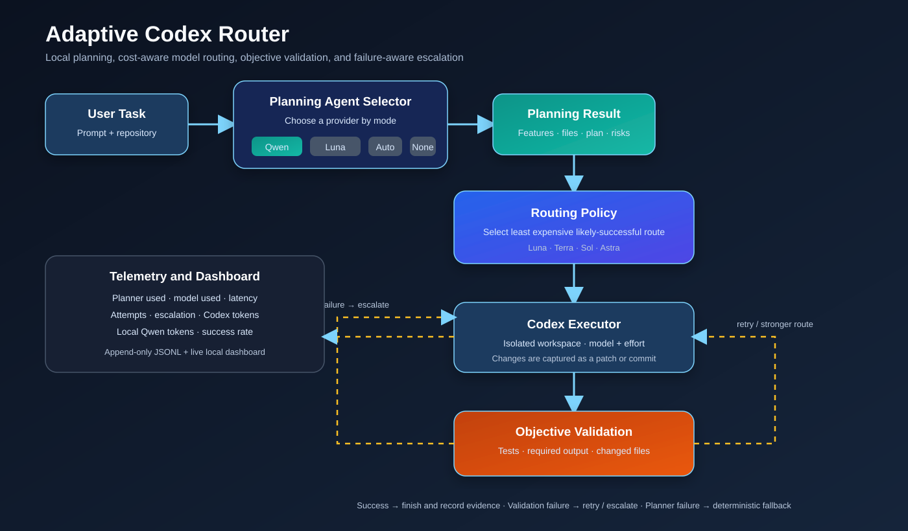
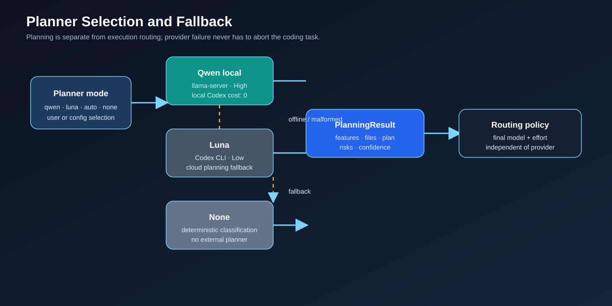
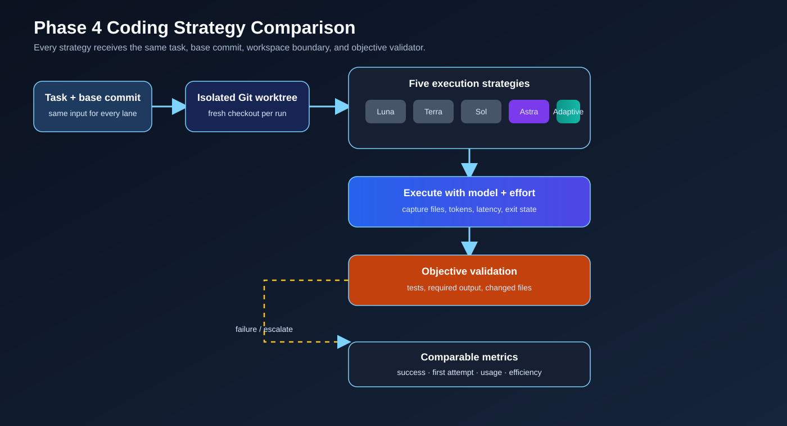
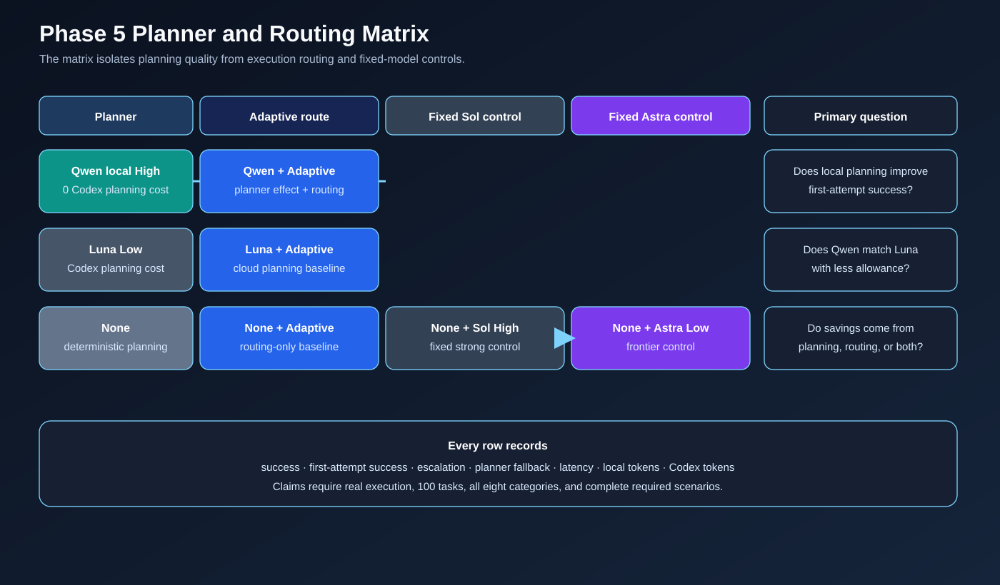
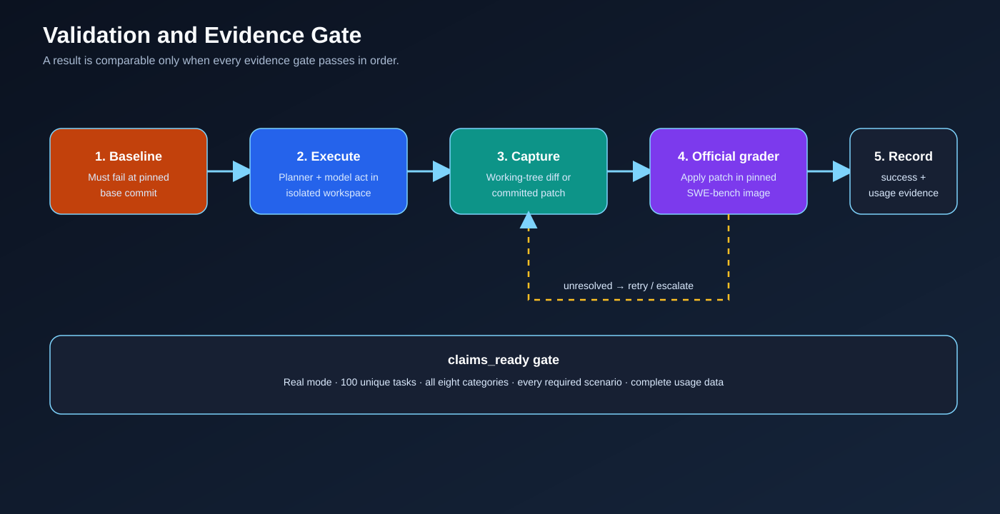
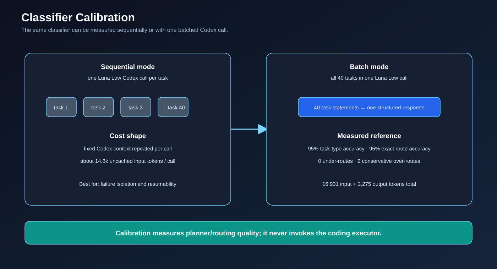

https://github.com/user-attachments/assets/a71b32ff-165e-4f11-8215-4b00d405eeba

# Adaptive Codex Router

A local, usage-aware wrapper that plans a coding task with a selectable provider
and routes it to the least expensive Codex model/reasoning pair likely to
succeed. The default planner is a local Qwen3.8-27B llama-server, so repository
analysis consumes no Codex allowance. Luna, automatic fallback, and deterministic
no-planner modes are also supported.



## What works now

- A provider-neutral `PlanningResult` with classification, relevant files,
  implementation steps, verification, risks, and an advisory execution tier.
- Local Qwen3.8-27B planning through llama-server with thinking enabled and high
  reasoning, plus GPT-5.6 Luna/Low planning through `codex exec`.
- `qwen`, `luna`, `auto`, and `none` modes. `auto` falls back Qwen -> Luna ->
  deterministic routing, and planner failure never aborts the coding task.
- Real routed coding execution with the selected model and reasoning effort.
- ChatGPT authentication only; API-key variables are removed from Codex calls.
- Strict JSON Schema output, timeout handling, and one malformed-output retry.
- A bounded repository snapshot for Qwen and read-only repository access for Luna.
- Git-working-tree preflight before planning, avoiding inference when the
  execution target is invalid.
- A workspace-write executor with ephemeral state and isolated user config.
- Exit status, final message, changed files, latency, cached input, output, and
  reasoning-token capture when the CLI reports them.
- Cancellation, timeout, launch-failure, and write-denial handling. Executor
  infrastructure failures are terminal and do not trigger a model escalation.
- Deterministic routing across Luna, Terra, Sol, and Astra.
- Model plus reasoning-effort selection.
- Configurable model availability and Astra-to-Sol fallback.
- Failure-aware escalation with a configurable three-attempt default.
- Astra XHigh/Max guardrails.
- Objective result validation.
- Privacy-conscious JSONL telemetry and aggregate metrics.
- Manual model/effort overrides and explain mode.
- A 40-case classifier/routing calibration dataset and evaluator.
- A resumable five-strategy coding benchmark with detached Git worktrees,
  pre-model baseline checks, external validation commands, and real/mock usage
  separation.

See [ARCHITECTURE.md](ARCHITECTURE.md) for the design,
[PHASE2_RESULTS.md](PHASE2_RESULTS.md) for classifier calibration, and
[PHASE3_RESULTS.md](PHASE3_RESULTS.md) for the real-executor verification.
[PHASE4_RESULTS.md](PHASE4_RESULTS.md) records the benchmark-framework status.
[PLANNING_PROVIDER_RESULTS.md](PLANNING_PROVIDER_RESULTS.md) records the provider
refactor and real local-Qwen smoke test.
[PHASE5_RESULTS.md](PHASE5_RESULTS.md) records the planner/Astra efficiency
framework and its mock verification.

## Run without installing

Python 3.11 or newer is required. On this Windows workspace, Python is managed by
`uv`, so the no-install command is:

```powershell
$env:UV_CACHE_DIR = "$PWD\.uv-cache"
$env:PYTHONPATH = "$PWD\src"
uv run --no-project --python 3.12 python -m adaptive_codex_router --explain "Fix a typo in README.md"
```

If `smart-codex` has been installed from this project, the equivalent command is:

```powershell
smart-codex --explain "Fix a typo in README.md"
```

The default run makes a local Qwen high-reasoning planning call and then lets the
selected coding model modify the target Git working tree. Always point
`--working-directory` at the intended repository. Use `--dry-run` to keep real
planning and routing but prevent file changes, or combine
`--planner none --dry-run` for a completely offline deterministic run.

## Exercise the flows

```powershell
python -m adaptive_codex_router --working-directory C:\path\to\repo --require-changed-files "Fix the typo in README.md"
python -m adaptive_codex_router --dry-run --explain "Implement pagination for the user list"
python -m adaptive_codex_router --planner auto --dry-run --explain "Debug a complex race condition across multiple modules"
python -m adaptive_codex_router --planner none --dry-run --mock-fail luna --explain "Fix a typo in README.md"
python -m adaptive_codex_router --planner none --dry-run --model astra --effort max "Architecture for a critical system"
```

The fourth command makes only Luna fail and shows the explicit Terra escalation.
The fifth command is expected to exit with code 2 because Astra Max was not
authorized. A deliberate manual Max run requires both flags:

```powershell
python -m adaptive_codex_router --planner none --dry-run --model astra --effort max --high-value --allow-max "Architecture for a critical system"
```

To simulate missing Astra availability:

```powershell
python -m adaptive_codex_router --planner none --dry-run --astra-unavailable --explain "Migrate the entire repository architecture; this is a very difficult multi-system task"
```

## Planning input

All providers receive the prompt, target workspace, and small metadata. Qwen is
sent a bounded text snapshot of the repository; Luna receives read-only Codex
access to the target. `none` reads no repository content.



```powershell
python -m adaptive_codex_router --metadata-json '{"files_explicitly_mentioned":3,"tests_requested":true,"cross_module_dependency":true}' "Implement the requested feature"
```

## Configuration

`config.yaml` contains the default planner, Qwen llama-server URL/model/context
and timeout settings, Luna fallback settings, executor sandbox/approval policy,
model IDs, supported efforts,
availability, guardrails, maximum attempts, reliability target, and telemetry
settings. Its contents use JSON syntax, which is valid YAML 1.2; this keeps the
runtime dependency-free with Python's standard library.

Prompts are not logged unless `telemetry.log_prompts` is explicitly enabled.
Runtime telemetry is written to `data/routing_history.jsonl` and ignored by Git.
Real executor events record the token fields exposed by Codex JSONL. The
`estimated_usage` field is used only by the mock and is not real Codex allowance.

## Tests

```powershell
$env:UV_CACHE_DIR = "$PWD\.uv-cache"
$env:PYTHONPATH = "$PWD\src"
uv run --no-project --python 3.12 python -m unittest discover -s tests -v
```

The suite covers Qwen's HTTP boundary, Luna's Codex subprocess boundary,
provider schema equivalence and fallback, authentication isolation, strict
output parsing, file detection, cancellation, timeouts, terminal
infrastructure failures, all four initial routes, availability fallback,
escalation, guardrails, validation, telemetry, and calibration metrics.

## Phase 4 coding benchmark

The five strategies are Always Luna High, Always Terra High, Always Sol High,
Always Astra Low, and Adaptive Router. Every real run receives a detached Git
worktree at the same resolved commit. A task's external validation command must
fail at that base commit before any model runs and pass after a valid solution.



Inspect the planned call volume without executing models:

```powershell
python -m adaptive_codex_router.benchmark.runner --mode real --limit 1 --strategies sol adaptive --plan
```

Exercise the full matrix with deterministic mocks:

```powershell
python -m adaptive_codex_router.benchmark.runner --mode mock --output data/phase4_results_mock.jsonl
```

A limited real run requires explicit volume authorization:

```powershell
python -m adaptive_codex_router.benchmark.runner --mode real --limit 1 --strategies sol adaptive --allow-real-execution --output data/phase4_results_sample.jsonl
```

Adding the Astra baseline also requires `--allow-astra-baseline`. A `--full` real
run is rejected until the dataset contains at least 100 tasks. Results append as
JSONL after each completed strategy and can be continued with `--resume`; a JSON
summary reports success, first-attempt success, escalation, attempts, latency,
model/effort/category distributions, routing quality, cached/uncached token use,
usage per success, efficiency, and Adaptive-vs-Sol/Astra savings.

See [benchmarks/README.md](benchmarks/README.md) and
[benchmarks/phase4_tasks.example.jsonl](benchmarks/phase4_tasks.example.jsonl)
for the corpus contract. The two checked-in fixture tasks are only for harness
verification and are not evidence of real model performance.

## Phase 5 planner and Astra efficiency

Phase 5 adds a scenario matrix over the Phase 4 task/worktree safeguards. The
default scenarios are Qwen/Luna/None + Adaptive, plus No Planner + Sol High and
No Planner + Astra Low. This separates planner effects from routing and retains
the original Astra efficiency comparison.





Inspect the real call volume without running a model:

```powershell
python -m adaptive_codex_router.benchmark.phase5 --dataset data/swebench_verified_reviewed.jsonl --workspace-backend swebench_container --validation-assets data/swebench_verified_candidates.validation.jsonl --mode real --limit 1 --plan
```

Run the free mock matrix:

```powershell
python -m adaptive_codex_router.benchmark.phase5 --mode mock --output data/phase5_results_mock.jsonl
```

Add Qwen/Luna + Always Sol controls with `--include-planned-sol-controls`.
Real runs require `--allow-real-execution`, a bounded `--limit` or explicit
`--full`, and `--allow-astra-baseline`. Full runs require at least 100 tasks and
all eight planned categories. The summary reports success, first-attempt
success, escalation, planner failure/fallback, planning latency, local planning
tokens, Codex usage, usage per successful task, and efficiency overall and by
category. `claims_ready` remains false until the real evidence requirements are
met.

Start real-corpus preparation with the pinned SWE-bench Verified importer. It
creates a source-valid candidate manifest without copying gold patches or
pretending the container evaluation script is a local Windows test command:

```powershell
python -m adaptive_codex_router.benchmark.corpus import-swebench --limit 100
python -m adaptive_codex_router.benchmark.corpus audit data/swebench_verified_candidates.jsonl
```

See [benchmarks/README.md](benchmarks/README.md) for the promotion blockers and
the stronger Git/claims audit.

The importer also writes a sealed `.validation.jsonl` sidecar for the official
SWE-bench harness. It includes grading-only test data that is never copied into
the model workspace, and each manifest row pins the matching asset hash. Install
the optional pinned harness and run the zero-model environment doctor:

```powershell
uv sync --extra phase5-swebench
.\.venv\Scripts\python.exe -m adaptive_codex_router.benchmark.phase5 --dataset data/swebench_verified_reviewed.jsonl --workspace-backend swebench_container --validation-assets data/swebench_verified_candidates.validation.jsonl --mode real --limit 1 --check-environment
```

The doctor checks the Docker Linux engine, official harness, and required
images. Missing images are reported but never pulled unless
`--allow-image-pull` is supplied explicitly.

Once Qwen and the environment are ready, a bounded pilot can run only Qwen
planning plus adaptive execution (at most three executor attempts):

```powershell
.\.venv\Scripts\python.exe -u -m adaptive_codex_router.benchmark.phase5 --dataset data/swebench_verified_reviewed.jsonl --workspace-backend swebench_container --validation-assets data/swebench_verified_candidates.validation.jsonl --mode real --limit 1 --scenarios qwen_adaptive --allow-real-execution --output data/phase5_qwen_pilot.jsonl
```

`--scenarios` filters the enabled matrix; its default remains all scenarios.
Selecting `none_astra` still requires `--allow-astra-baseline`. Adaptive routing
and its escalation policy are unchanged. A pilot is not evidence of savings.
On Windows, the adapter preserves UTF-8/LF for Linux grading artifacts. Baseline
acceptance requires executed failing target tests, not just `resolved=false`.
SWE-bench execution uses the global `--ask-for-approval never` option with
workspace-write isolation; it must not be silently changed to automatic approval.

## Local dashboard

The dependency-free dashboard reads Phase 5 JSONL artifacts from `data/` and
refreshes every five seconds. It shows task success, planner/model distribution,
latency, Codex tokens, local Qwen tokens, attempts, and stop reasons:

```powershell
Set-Location 'C:\Users\ivank\Desktop\Adaptive-Codex-Router'
.\.venv\Scripts\python.exe -m adaptive_codex_router.dashboard
```

Open [http://127.0.0.1:8766](http://127.0.0.1:8766) (or use `--port 8765` when
available). Use `--data-dir <path>` to observe another results directory.
The dashboard also has a task form: choose a planner, enter a Git repository
path, or click `Browse…` to use the native Windows folder picker, and submit a
prompt. It launches the existing CLI in a background job; the job status and
output appear below the metrics. The browser cannot expose absolute paths by
itself, so the picker is provided by the local dashboard process.

Generate a resumable Qwen High category proposal without exposing sealed
grading data:

```powershell
python -m adaptive_codex_router.benchmark.category_review --batch-size 25
```

This writes JSONL proposals, a distribution summary, and a Markdown confirmation
checklist. Qwen labels are advisory and never clear `human_review_required`.

Apply a hash-pinned, user-delegated review decision without overwriting the Qwen
proposal artifact:

```powershell
python -m adaptive_codex_router.benchmark.category_finalize
python -m adaptive_codex_router.benchmark.corpus audit data/swebench_verified_reviewed.jsonl
```

The checked-in decision record confirms 95 proposals and modifies 5 from
`normal_implementation` to `debugging`. The resulting reviewed manifest clears
the review gate while retaining the suggested category, final category,
reviewer, authority, timestamp, and decision hash in provenance.

## Classifier calibration



The checked-in dataset contains 40 synthetic tasks. A mock run is free and useful
for verifying the harness:

```powershell
python -m adaptive_codex_router.benchmark.evaluator --classifier mock
```

A real sequential run makes one Luna/Low Codex call per case, writes no prompt
into its result file, stops on the first classifier error, and never invokes a
coding executor. Start with a small sample:

```powershell
python -m adaptive_codex_router.benchmark.evaluator --classifier codex --limit 3
```

For full calibration, batch all 40 tasks into one Luna call so the fixed CLI
context is paid once:

```powershell
python -m adaptive_codex_router.benchmark.evaluator --classifier codex --batch
```

The completed reference run achieved 95% task-type accuracy and 95% exact-route
accuracy, with zero under-routes and two conservative over-routes. It used 16,931
input and 3,275 output tokens for the whole batch.

The real sequential evaluator refuses an unbounded run. Use `--full` only when
you intentionally authorize 40 separate calls. Current measurements show
about 14.3k uncached input tokens per classifier call even with the tiny task
payload, because `codex exec` supplies its own fixed agent context. A full run
would therefore consume roughly 573k input tokens before any coding execution.
That overhead is a Phase 2 go/no-go metric, not something to hide.

Phase 3's controlled real-executor smoke test succeeded in one Luna/Low attempt,
but consumed 59,770 input tokens (51,200 cached) for a one-line edit. Phase 4's
harness is now ready, but no real comparative matrix has been run. Do not claim
usage savings until at least 100 objectively validated real tasks are collected
and executed across the required baselines.
